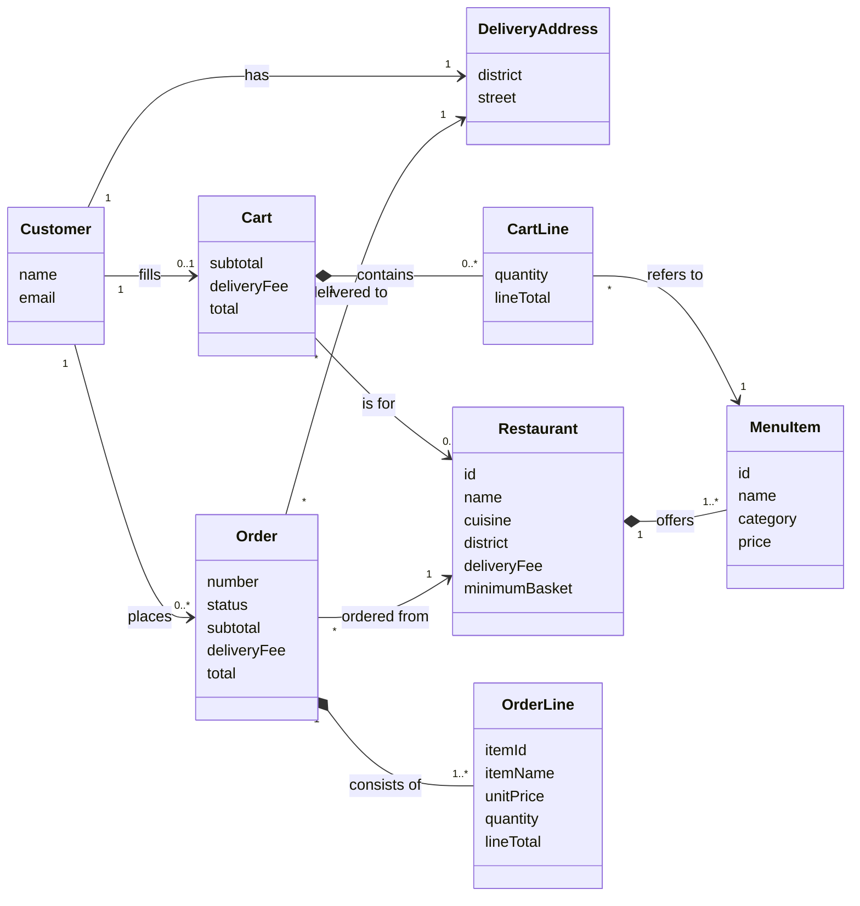

# Domain Model (D5)

Conceptual UML domain model showing domain concepts, attributes, associations, association names, and multiplicities. Following Larman's guidelines and the Iteration 1 brief, this diagram contains **no methods, no Java types, and no UI or infrastructure classes**.

*(PlantUML source is also maintained at [`docs/diagrams/domain-model.puml`](diagrams/domain-model.puml).)*

## Conceptual Notes & Business Rule Alignment
- **Cart ↔ Restaurant (`0..1`, BR-2):** An empty cart has no restaurant (`0`); a non-empty cart is associated with exactly one restaurant (`1`).
- **CartLine → MenuItem (BR-3):** Within a cart, each `MenuItem` appears on at most one `CartLine`; adding the same item again increases `quantity` (`1..20`, BR-1).
- **OrderLine is an Independent Snapshot, Not Linked to MenuItem (BR-7):** `OrderLine` intentionally has **no association arrow to `MenuItem`**. Instead, it copies `itemId`, `itemName`, `unitPrice`, `quantity`, and `lineTotal` at the moment the order is placed so that future menu edits in Iteration 2 never alter a historical order (see [`docs/design-decisions.md`](design-decisions.md)).
- **Derived Totals (BR-5):** `subtotal`, `deliveryFee`, and `total` are calculated by `Cart` and copied into `Order` upon placement.
- **Order Identity & Lifecycle (BR-6):** Each `Order` receives a unique, strictly increasing `number` (starting at `1001`) and starts in status `PLACED`.
- **Customer Identity (BR-8):** Each `Customer` is uniquely identified by `email` (containing `@`) and holds a required `DeliveryAddress` (BR-4).
