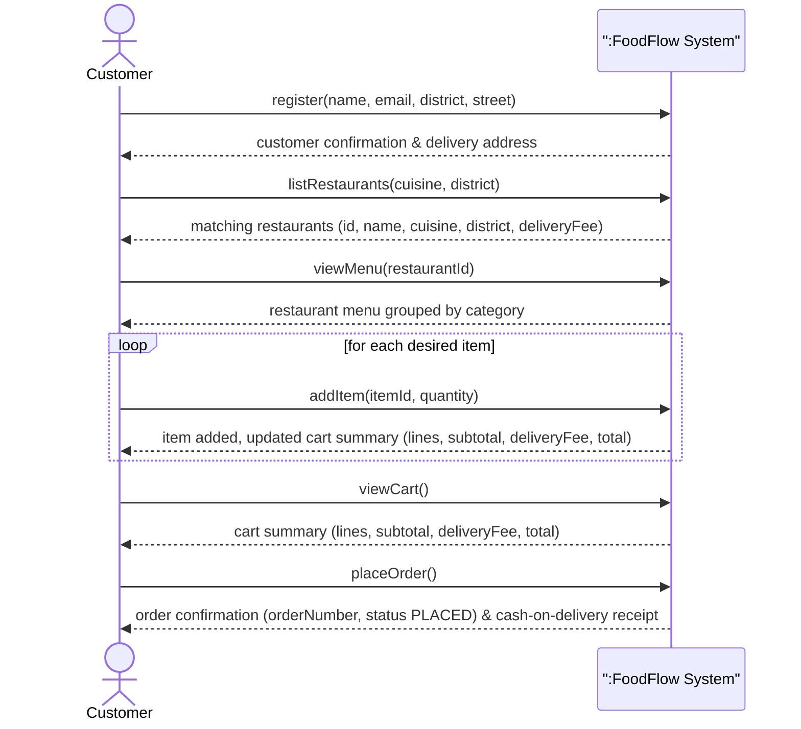

# System Sequence Diagram and Operation Contracts (D6)

## System Sequence Diagram – Place Order (Main Success Scenario)

Each system operation in the SSD corresponds directly to a public method on `foodflow.application.OrderingService`.

*(PlantUML source is also maintained at [`docs/diagrams/ssd-place-order.puml`](diagrams/ssd-place-order.puml).)*

### Mapping of SSD System Operations to `OrderingService`
- `register(name, email, district, street)`
- `login(email)`
- `listRestaurants(cuisine, district)`
- `viewMenu(restaurantId)`
- `addItem(itemId, quantity)`
- `changeQuantity(itemId, quantity)`
- `removeItem(itemId)`
- `clearCart()`
- `viewCart()`
- `placeOrder()`
- `myOrders()`

---

## Operation Contract CO1: `addItem(itemId, quantity)`

- **Operation:** `addItem(itemId, quantity)`
- **Cross References:** Use Cases *Manage Cart (UC5)*, *Place Order (UC6)*
- **Preconditions:**
  - A `Restaurant` in `RestaurantCatalog` offers a `MenuItem` whose `id` matches `itemId` (case-insensitive).
  - `quantity` is an integer between `1` and `20` inclusive (BR-1).
  - The current `Cart` is either empty or already associated with the `Restaurant` that offers `itemId` (BR-2).
  - If the `Cart` already contains a `CartLine` for `itemId`, the sum `existingLine.quantity + quantity` does not exceed `20` (BR-1, BR-3).
- **Postconditions:**
  - *Instance creation / modification:*
    - If no `CartLine` for `MenuItem` existed in `Cart`, a new `CartLine` instance `cl` was created with `cl.quantity = quantity` and associated with `MenuItem` and `Cart`.
    - If a `CartLine` `cl` for `MenuItem` already existed in `Cart`, `cl.quantity` became `cl.quantity@pre + quantity` and no new `CartLine` instance was created (BR-3).
  - *Associations formed:*
    - If `Cart` was empty prior to the operation, an association between `Cart` and the item's `Restaurant` was formed (BR-2).
  - *Attribute / derived state changes:*
    - `cl.lineTotal` became `MenuItem.price * cl.quantity`.
    - `Cart.subtotal` increased by `MenuItem.price * quantity`, and `Cart.total` became `Cart.subtotal + Restaurant.deliveryFee` (BR-5).
  - *Failure atomicity:*
    - If any precondition fails, no instances are created, no associations are changed, and `Cart` remains in its state prior to the call.

---

## Operation Contract CO2: `placeOrder()`

- **Operation:** `placeOrder()`
- **Cross References:** Use Case *Place Order (UC6)*
- **Preconditions:**
  - A `Customer` is currently identified in the session and is associated with a valid `DeliveryAddress` (`district` and `street`, BR-4).
  - The `Cart` is not empty (`Cart.lines` contains at least one `CartLine`, and `Cart` is associated with a `Restaurant`, BR-4).
- **Postconditions:**
  - *Instance creation:*
    - A new `Order` instance `o` was created.
    - For each `CartLine` `cl` in `Cart`, a new immutable `OrderLine` instance `ol` was created and associated with `o` (BR-7).
  - *Attribute modifications:*
    - `OrderNumberGenerator.next` was incremented, and `o.number` was set to the generated unique, strictly increasing order number (starting at `1001`, BR-6).
    - `o.status` was set to `OrderStatus.PLACED` (BR-6).
    - For each created `OrderLine` `ol`: `ol.itemId = cl.item.id`, `ol.itemName = cl.item.name`, `ol.unitPrice = cl.item.price`, `ol.quantity = cl.quantity`, and `ol.lineTotal = cl.lineTotal` (snapshot at order time, BR-7).
    - `o.restaurantName` was set to `Cart.restaurant.name`.
    - `o.subtotal` was set to `Cart.subtotal`, `o.deliveryFee` was set to `Cart.deliveryFee`, and `o.total` was set to `Cart.total` (`subtotal + deliveryFee`, BR-5).
  - *Associations formed and broken:*
    - `o` was associated with the current `Customer` and the customer's `DeliveryAddress`, and added to the session's `placedOrders` collection.
    - All `CartLine` instances were removed from `Cart`, and the association between `Cart` and `Restaurant` was cleared so `Cart.isEmpty() == true` (BR-7).
  - *Failure atomicity:*
    - If any precondition fails, no `Order` or `OrderLine` is created, `OrderNumberGenerator` does not consume a number, and `Cart` remains unchanged.
