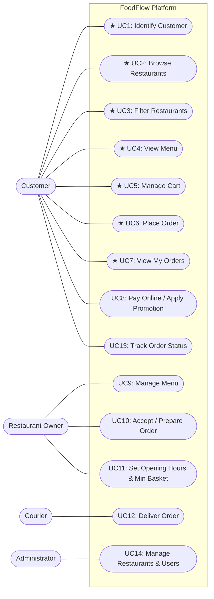

# Use-Case Model (D3)

## Use-Case Diagram – Whole Product

Iteration 1 (I1) use cases are marked with **★**.

*(PlantUML source is also maintained at [`docs/diagrams/use-cases.puml`](diagrams/use-cases.puml).)*

---

## Brief Use Cases (Iteration 1)

| ID | Use Case | Primary Actor | Brief Description |
|---|---|---|---|
| **UC1** | Identify Customer | Customer | The customer registers with a name, unique e-mail address containing `@` (BR-8), and a delivery address (district and street, BR-4), or logs in as an existing customer in the current session using their e-mail. |
| **UC2** | Browse Restaurants | Customer | The customer requests the full list of restaurants and views each restaurant's ID, name, cuisine, district, and delivery fee formatted in TL (BR-5). |
| **UC3** | Filter Restaurants | Customer | The customer filters restaurants by cuisine and/or district (case- and Turkish-diacritic-insensitive); if no restaurant matches, the system reports the empty result politely. |
| **UC4** | View Menu | Customer | The customer selects a restaurant by ID and views its menu items grouped by category in order of appearance, with positive unit prices in TL (BR-1, BR-5). |
| **UC5** | Manage Cart | Customer | The customer adds items with quantities, updates item quantities, removes items, clears the cart, and views line totals, subtotal, delivery fee, and total (fully dressed below). |
| **UC6** | Place Order | Customer | The identified customer places a cash-on-delivery order for their non-empty cart, receiving a unique increasing order number, `PLACED` status, and a formatted receipt while the cart is emptied (fully dressed below). |
| **UC7** | View My Orders | Customer | The identified customer lists all orders they have placed during the current session with their order numbers, restaurants, statuses, and totals. |

---

## Fully Dressed Use Case 1: Manage Cart (UC5)

- **Scope:** FoodFlow console application
- **Level:** User goal
- **Primary Actor:** Customer
- **Stakeholders and Interests:**
  - *Customer:* Wants accurate line totals, subtotal, delivery fee, and total without unexpected changes; wants clear feedback when a rule is violated.
  - *Restaurant:* Wants every cart and resulting order to contain only items from its own menu.
- **Preconditions:** The restaurant catalog has been loaded from `data/restaurants.json`. (Customer identification is not required to manage the cart.)
- **Success Guarantee (Postconditions):** The cart reflects the customer's selections: at most one line per menu item (BR-3), quantities between 1 and 20 (BR-1), all items belonging to a single restaurant (BR-2), and accurate totals calculated in the domain (BR-5).
- **Trigger:** The customer issues a command to add an item, change an item's quantity, remove an item, view the cart, or clear the cart.

### Main Success Scenario
1. The customer selects a menu item ID and specifies a quantity to add.
2. The system verifies that the menu item exists, validates the quantity (BR-1), verifies that the item belongs to the same restaurant as the cart (BR-2), adds the item to the cart (an item already in the cart only gets a higher quantity, BR-3), and displays the updated cart with line totals, subtotal, delivery fee, and total (BR-5).
3. The customer repeats steps 1-2 for additional menu items.
4. The customer requests to change the quantity of an item in the cart.
5. The system validates the new quantity (BR-1), updates the cart line, and displays the updated cart.
6. The customer requests to remove an item from the cart.
7. The system removes the corresponding line and displays the updated cart.

### Extensions (Alternative Flows & Business Rule Violations)
- 1a. The customer only wants to see the cart (`cart`):
  1. If the cart has items, the system displays the restaurant name, each cart line (item ID, quantity, name, line total), subtotal, delivery fee, and total (BR-5).
  2. If the cart is empty, the system informs the customer that the cart is empty.
- 2a. The menu item ID does not exist (BR-9):
  1. The system rejects the operation with a clear message naming the unknown item ID; the cart remains unchanged.
- 2b. The quantity is missing or not a whole number (BR-9):
  1. The system informs the customer that quantity must be a whole number; the cart remains unchanged.
- 2c. The quantity is less than 1 or greater than 20 (BR-1):
  1. The system rejects the operation stating that quantity must be between 1 and 20; the cart remains unchanged.
- 2d. The item belongs to a different restaurant than the items currently in the cart (BR-2):
  1. The system refuses to add the item and informs the customer which restaurant the cart currently belongs to, advising them to empty the cart first (`clear`).
  2. The cart remains unchanged.
- 2e. The item is already in the cart (BR-3):
  1. The system adds the new quantity to the existing cart line instead of creating a second line.
- 2e1. The summed quantity of that line would exceed 20 (BR-1, BR-3):
  1. The system rejects the addition and keeps the existing line's previous quantity.
- 5a. The new quantity is less than 1 or greater than 20 (BR-1):
  1. The system rejects the update; the cart line retains its previous quantity.
- 5b. The item whose quantity should change is not in the cart (BR-9):
  1. The system reports that the item is not in the cart; the cart remains unchanged.
- 6a. The customer empties the whole cart (`clear`) instead of removing one item:
  1. The system removes all cart lines and resets the cart's restaurant association, so any restaurant can be used next (BR-2).
- 7a. The item to remove is not in the cart (BR-9):
  1. The system reports that the item is not in the cart; the cart remains unchanged.
- 7b. The removed line was the last one (BR-2):
  1. The system clears the cart's restaurant association so the customer may now add items from any restaurant.
- *a. Invalid command syntax or option at any time (BR-9):
  1. The system prints a friendly error message without terminating the program, allowing the customer to continue.

### Special Requirements
- All monetary amounts must be rounded to 2 decimal places (`HALF_UP`) and displayed with the `TL` suffix (BR-5).

---

## Fully Dressed Use Case 2: Place Order (UC6)

- **Scope:** FoodFlow console application
- **Level:** User goal
- **Primary Actor:** Customer
- **Stakeholders and Interests:**
  - *Customer:* Wants an immediate confirmation with an order number, delivery address, itemized receipt, and exact cash-on-delivery total.
  - *Restaurant:* Wants a complete, immutable record of the items and prices agreed upon at the moment of ordering.
  - *Course Staff / Future Iterations:* Requires that future menu price modifications in Iteration 2 never alter the total or lines of an already placed order (BR-7).
- **Preconditions:**
  - The customer is identified in the current session with a valid delivery address (UC1, BR-4).
  - The customer's cart contains at least one cart line (UC5, BR-4).
- **Success Guarantee (Postconditions):**
  - A new `Order` is created with a unique, strictly increasing order number (BR-6) and initial status `PLACED` (BR-6).
  - Each `CartLine` is copied into an immutable `OrderLine` snapshot recording item ID, item name, unit price, quantity, and line total at the moment of ordering (BR-7).
  - The order total equals the cart subtotal plus the restaurant's delivery fee (BR-5).
  - The customer's cart is emptied and disassociated from the restaurant (BR-7).
  - The order is recorded in the customer's session order history (F7) and a formatted receipt is printed.
- **Trigger:** The customer enters the `order` command.

### Main Success Scenario
1. The customer requests to place an order for the current cart.
2. The system verifies that a customer is identified with a delivery address and that the cart is non-empty (BR-4).
3. The system snapshots all cart lines into immutable order lines carrying item ID, name, unit price, quantity, and line total (BR-7).
4. The system allocates the next unique, increasing order number and sets the order status to `PLACED` (BR-6).
5. The system records the order's subtotal, the restaurant's delivery fee, and the total amount (BR-5), and associates the order with the customer and their delivery address.
6. The system empties the cart (BR-7) and adds the order to the session's placed orders.
7. The system prints the order confirmation message and a detailed cash-on-delivery receipt showing the order number, status, restaurant, customer, delivery address, itemized lines, subtotal, delivery fee, total in `TL`, and payment method.

### Extensions (Alternative Flows & Business Rule Violations)
- 2a. No customer is currently identified (BR-4):
  1. The system refuses to place the order and instructs the customer to identify themselves first (`register` or `login`).
  2. No order is created, no order number is consumed, and the cart remains untouched.
  3. The customer registers or logs in (UC1) and continues at step 1.
- 2b. The cart is empty (BR-4):
  1. The system refuses to place the order and informs the customer that the cart is empty.
  2. No order is created and no order number is consumed.
  3. The customer adds items (UC5) and continues at step 1.
- 2c. The customer has no delivery address (BR-4):
  1. The system refuses to place the order. (A customer cannot be registered without an address, so this cannot happen in Iteration 1; the check is still made in the domain.)
- *a. Invalid command input at any time (BR-9):
  1. The system displays a clear error message and keeps the session running.

### Special Requirements
- All monetary amounts on the confirmation line and receipt are displayed with two decimals and `TL` (BR-5).
- Payment method in Iteration 1 is exclusively cash on delivery.

### Open Issues (Deferred to Iteration 2)
- Restaurant minimum basket (`minimumBasket`) and opening hours validation will be added as extensions at step 2 in Iteration 2.
